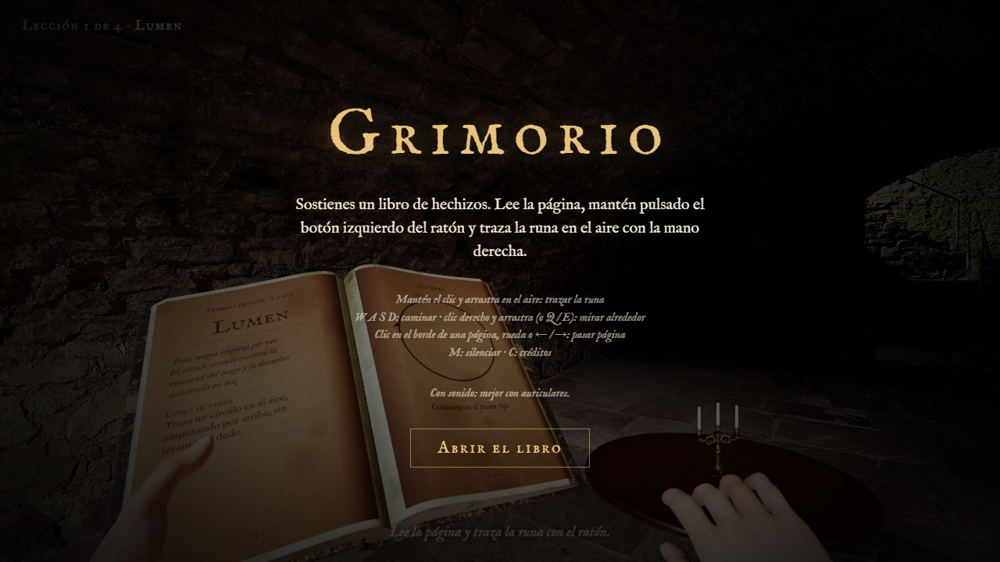
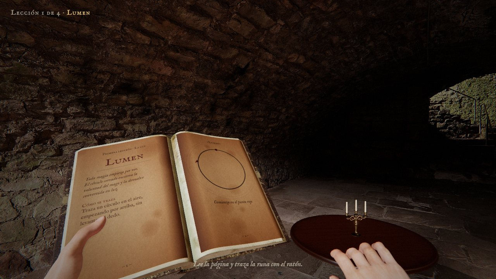

<div align="center">

# Grimorio

**Sostienes un libro de hechizos en una cripta. Lee la página y traza la runa en el aire con la mano.**

[](https://virtuanista.github.io/magical/)




</div>

## Qué es

Una experiencia corta en primera persona. Estás en una cripta iluminada por velas y tienes en las manos un viejo grimorio. Cada página enseña un hechizo: para lanzarlo, mantienes pulsado el ratón y dibujas la runa en el aire. Si el trazo se parece, el hechizo se activa.



| Lección | Hechizo |
|---|---|
| 1 | **Lumen**: la luz |
| 2 | **Ignis**: el fuego |
| 3 | **Fulgur**: el rayo |
| 4 | **Ventus**: el viento |

## Cómo jugar

Entra en **[virtuanista.github.io/magical](https://virtuanista.github.io/magical/)** y pulsa *Abrir el libro*. Mejor con auriculares.

| Acción | Control |
|---|---|
| Trazar la runa | Mantener el clic izquierdo y arrastrar en el aire |
| Caminar | W A S D |
| Mirar alrededor | Clic derecho y arrastrar, o Q / E |
| Pasar página | Clic en el borde de la página, rueda o ← / → |
| Silenciar · créditos | M · C |

### En local

```bash
npm install
npm run dev        # http://localhost:5180
npm run build      # versión estática en dist/
```

## Curiosidades técnicas

- **Reconocimiento de gestos**: el trazo del ratón se compara con la forma de cada runa (`src/gesture.js`).
- **Manos animadas por código**: las poses de los brazos y los dedos se calculan en tiempo real (`src/arms.js`), y las páginas del libro se reescribieron con las lecciones (`src/book.js`).
- **Luz y partículas** propias para cada hechizo (`src/vfx.js`), con la iluminación HDRI de una bodega real.

## Créditos y licencias

El código es original y se publica con licencia [MIT](LICENSE). Los recursos de terceros conservan su propia licencia. Las atribuciones CC BY también aparecen dentro del juego (tecla C).

| Recurso | Autor | Licencia |
|---|---|---|
| Brazos y manos «Fists (2025) · First Person Animations» | [1Matzh](https://sketchfab.com/3d-models/c7e8f959c4094be991b02213d4e66c20) | CC BY 4.0 (modificado) |
| Libro «Aged Alchemical Book (mid-poly!)» | [LOLIPOP](https://sketchfab.com/3d-models/b8f02036e3ab496ea025d390668b5c00) | CC BY 4.0 (modificado) |
| HDRI «Castle Zavelstein Cellar» | [Andreas Mischok · Poly Haven](https://polyhaven.com/a/castle_zavelstein_cellar) | CC0 |
| Mesa y candelabros | [Poly Haven](https://polyhaven.com/models) | CC0 |
| Flipbooks SmallFlame01 y WispySmoke01 | [Unity Labs](https://unity.com/blog/engine-platform/free-vfx-image-sequences-flipbooks) | CC0 |
| Sonidos (libro, cerilla, golpes, swooshes, chispazo) | [FilmCow](https://filmcow.itch.io/filmcow-sfx) | Libre de derechos (licencia FilmCow) |
| Ambiente de cueva, fuego, viento y pasos | [NOX Sound](https://nox-sound-design.itch.io/essentials-series-sfx-nox-sound) | CC0 |
| Trueno y viento | [Helton Yan](https://heltonyan.itch.io/weatherelements) | CC BY 4.0 (modificado) |
| Icono «Heavy thorny triskelion» | [Lorc · game-icons.net](https://game-icons.net) | CC BY 3.0 (modificado) |
| Textura Paper006 | [ambientCG](https://ambientcg.com/view?id=Paper006) | CC0 |
| Tipografía IM Fell English | Igino Marini · Google Fonts | OFL |

<details>
<summary><b>In English</b></summary>

*Grimorio* is a short first-person browser experience built with three.js: you hold a spellbook in a candle-lit crypt and cast spells by tracing runes in the air with the mouse. [Play it in your browser](https://virtuanista.github.io/magical/). The code is MIT; third-party assets keep their own licenses (see the table above).

</details>
